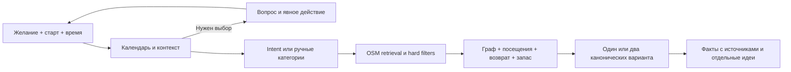

# Qadam VNext: решения и границы

## Продуктовый выбор

«До встречи есть время на маленькое открытие». Qadam связывает желание, выбранный старт и окно времени с реальными местами и обязательным возвращением. Пользователь выбирает подходящий вариант и видит, на чём он основан. Это гипотеза ценности; превосходство над картами, спрос и retention пока не доказаны.

Вместо скрытого угадывания — понятный вопрос с 2–4 действиями и своим ответом. Варианты `manual-category`, `set-origin`, `external-search`, `retry`, `edit-query` закрыты типами. Свободный ответ остаётся текстом для интерпретатора, а не доверенным intent. Предыдущие ограничения сохраняются, пока пользователь явно их не меняет; неоднозначность требует уточнения.

## Поток решения

Известный конфликт текста со стартом, например Mega против Байтерека, обрабатывается до AI. Подтверждение не геокодирует произвольный адрес и не доказывает вход. Выбор старта включает пресеты, локальный поиск названных POI, отдельный pin mode и GPS по нажатию. За границей корпуса предлагаются изученные районы. Прямоугольник POI и доступность графа — разные проверки.

Для футбола/матчей/shopping нет data path; новые категории не добавляются формально ради демо. Предлагается явный внешний поиск с раскрытой границей. Уличное искусство не выдаётся за подтверждённую галерею. При поддержанной категории и неизвестной тишине/цене/Wi-Fi допустим `partial`; подтверждать неизвестный факт бессмысленно.

## Граница AI

Семантический запрос проходит строгий `IntentContract`: восемь категорий, desired/excluded, all/any, цитаты с причинами и флаг уточнения. Неизвестные поля, пересечения, повторы и чужие цитаты отклоняются. Default chips не добавляют кофе к текстовому музею. При явной смене цели прежнее занятие не переносится в unsupported; неотозванные hard exclusions сохраняются. Это правило интерпретации, не гарантия отсутствия ошибок модели. Форма не доказывает понимание языка: ошибки интерпретации измеряются отдельно.

Пустой текст использует явные ручные категории. При недоступном первом этапе текст не превращается в guessed route. Кнопка ручного восстановления очищает query и включает `localOnly`: обе AI-стадии пропускаются, старт/время/переключатели остаются. Это осознанный новый выбор пользователя.

Retrieval — категории, география и словарные признаки; embeddings и векторной БД нет. Код применяет hard exclusions, indoor, wheelchair и весь визит по расписанию до показа плана. `all` повышает покрытие разных категорий, но не ослабляет фильтры и бюджет: partial/empty остаются допустимыми.

Необязательная генерация для **основного** плана возвращает закрытые `summaryKey/reasonKeys/activityKey`, точные ID в исходном порядке и только разрешённые per-stop коды. Свободной venue-прозы нет. Ответ проходит shape и semantic guard; renderer не может менять маршрутные факты. Альтернативный план объясняется локально, без второго дополнительного вызова. `generationMode` относится к основному объяснению, локальная альтернатива отмечена в diagnostics/trace. Сбой второго этапа сохраняет проверенный план.

Общий срок ожидания модельных стадий — до 14,5 секунды. Parent AbortSignal передаётся обеим стадиям, охватывает fetch/body и останавливает переход к следующей; ограниченный Promise.race защищает от транспорта, игнорирующего сигнал. API возвращает отмену отдельно от ошибки планирования. Это предел ожидания, не обещание latency.

## Время и варианты

`now`/`returnBy` требуют настоящего календарного ISO с Z или явным смещением. Проверяются длина месяца, leap year, время и UTC+5. Пользовательские wall-clock значения всегда относятся к Алматы, а не timezone устройства. Явное прошлое custom-время отклоняется; исторические offline fixtures без custom mode сохраняются для воспроизводимости.

При «Сейчас» и `returnBy` сервер заново считает остаток после интерпретации и округляет вниз до минут. Если окно или выбранное custom-отправление устарели, возвращается typed clarification. Ответ фиксирует departureAt, planComputedAt, returnBy, effectiveMinutes. Полный return+buffer всегда входит в лимит. Реальное прибытие не гарантируется.

До трёх остановок, обычно разных категорий; shortlist до 18. Production ranking предпочитает source richness: reviewed facts=2, исходное имя OSM=1, generated label=0, с bounded score bonus до 4. Покрытие all сравнивается раньше содержательности; все hard filters и время остаются обязательными. Альтернатива также сначала ищет другой допустимый named/curated POI. Это содержательность карточки, не отзывы, безопасность или доказанное качество места. Без callback legacy direct planner сохраняет прежнее ранжирование. CSR, binary heap и Dijkstra учитывают сеть **до** выбора. Не более четырёх поисковых деревьев суммарно для основного и второго варианта. Альтернатива заменяет конечное место при сохранении допустимого префикса, использует кэш и обратное origin-tree; это bounded heuristic, не глобальный all-pairs optimum. Если нет другого канонического набора с измеримой разницей затрат — остаётся один вариант. Перестановка тех же мест не считается разнообразием.

## Данные и содержательные объяснения

OSM snapshot: 890 записей, 81 383 узла/97 427 рёбер. Provenance сохраняет источники, дату и hash. Редакционный слой отдельно содержит 10 канонических мест, 11 явных OSM-ID, 19 атомарных фактов и 4 идеи наблюдения. У факта есть localized text, sourceUrl, checkedAt, rights. Источник проверен онлайн; полевая актуальность этим не подтверждается.

Канонические алиасы только явные. У Национального музея проверены named node внутри building polygon и совпадение адреса/официального сайта. Радиус близости сам по себе не объединяет POI. Overlay меняет отображаемое имя/описание, сохраняя исходные координаты, теги, расписание и filter/routing-поля. Исторический факт не означает, что дверь сейчас открыта; наблюдение подписывается как идея.

774 записи без raw hours, сложные часы остаются unknown; 8 indoor и 21 wheelchair=yes/designated дают мало строгих вариантов. Привязки ≤200 м — прямая, препятствия/входы не проверены. Estimate = прямая ×1,35 только при отсутствии покрытия, не для сокращения известного длинного пути. Wheelchair и запрет лестниц не сертифицируют весь путь. Матчи, ассортимент, цены, тишина и crowding не подтверждены.

## Приватность и проверка

Приложение не пишет query/координатную историю в БД или browser storage. По действию сохраняются только ID публичных любимых мест на устройстве с очисткой. Старт нужен серверу для расчёта; структурированный старт и время не входят в intent payload. Query может содержать личные сведения и передаётся провайдеру. Тайлы OSM и технические журналы внешней инфраструктуры — отдельный слой.

Исторические 167 тестов, чистая установка и intent benchmark относятся к прежнему выпуску. Замороженные 26/30 против 7/30 legacy, 27 API+3 manual и две 429 не пересчитываются новыми пробами. Новые автоматические regressions покрывают контекст, время, восстановление, abort, guards, альтернативы и источники. Итог текущего набора — в финальном gate-логе; browser QA и API smoke учитываются отдельно. Матрица 34 сценариев аудита не является 34 успешными проверками. [Метод старого прогона](EVALUATION.md) · [Новый release gate](VNEXT_RELEASE.md).

Следующие шаги после релиза: новые независимые запросы, наблюдение за добровольными пользователями, полевая проверка входов/часов и доступности, обновление корпуса и работа с квотами. Пилот, партнёрства, продажи и экономика пока гипотезы.
