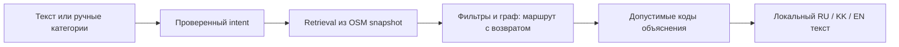

# Qadam v4: решения, границы и демонстрация

## Продукт

«У меня есть 45 минут — куда выйти и успеть вернуться?» Qadam показывает 1–3 места, полный расчёт времени и источники. В v4 пользователь также видит трактовку запроса: желаемые/исключённые категории, «все / любой», неподтверждаемые пожелания и итог `matched`, `partial`, `empty` либо `needs-clarification`.

Это специализация продукта, а не утверждение, что другие карты не умеют планировать маршруты.

## Pipeline и границы AI

Пустой текст использует ручные кнопки без модели интерпретации. Непустой текст проходит Gemini и строгий `IntentContract`: восемь категорий, раздельные desired/excluded, `all/any`, цитаты из исходного запроса с причинами `no-data/use-controls/not-supported`, флаг уточнения. Неизвестные поля, повторы, конфликт desired/excluded и чужие цитаты отклоняются. Текст не меняет координаты, бюджет или переключатели самовольно. Явный конфликт с ними требует уточнения.

Нет ключа, таймаут, HTTP 429 или невалидная интерпретация → план не строится по догадке; интерфейс предлагает уточнить запрос или явно перейти к ручному выбору. Категорийное пожелание с неподтверждаемыми качествами может дать `partial` с видимыми цитатами неизвестного. Запрос только о качествах без категории требует уточнения. Чистые исключения разрешены. Валидатор ограничивает форму и допустимые категории, но не доказывает правильность понимания языка: это измеряется отдельно.

Retrieval — категорийные, географические и словарные признаки корпуса; embeddings и векторной БД нет. В API категории intent авторитетны, default chips не добавляются к музею из текста. Исключения проверяются до выбора. Shortlist — до 18 кандидатов с разнообразием. До трёх остановок, разные категории. `all` повышает покрытие; бюджет и подтверждённые фильтры не ослабляются ради полного результата.

Пути: CSR-массивы, binary heap, Dijkstra. Сетевые расстояния учитываются до выбора; максимум четыре поисковых дерева на запрос. Сначала более редкая/длительная запрошенная категория при `all`, затем допустимые дополнения. Это ограниченная эвристика, не глобальная оптимизация. При геометрическом fallback перебираются короткие варианты shortlist.

План включает переходы, обратный путь, посещения и запас 8% бюджета, ограниченный 3–10 минутами. Скорость и посещения — продуктовые предположения. Поддерживаемое расписание проверяется на весь визит в `Asia/Almaty`; `now` принимает только ISO с `Z` либо явным смещением. Будущая дата показана в UI.

Второй вызов Gemini выбирает **коды**, а не свободный фактологический текст: `summaryKey`, точные ID в прежнем порядке, допустимые для каждой остановки `reasonKeys/activityKey`. `listed-hours` доступен только при подтверждённом по расписанию визите; category-match — по проверенному intent; time-budget — при согласованных суммах. Код локально выводит проверенные формулировки и подписывает занятия как идеи. Старая free-prose схема отвергается. При сбое этого этапа уже вычисленный план сохраняется в `retrieval`. У двух модельных этапов общий deadline до 14,5 секунды; это лимит ожидания, не обещание latency.

## Данные, приватность, риски

890 POI, 81 383 узла и 97 427 рёбер покрывают центральную Астану. Сбор повторяемый, с provenance. У 774 POI нет часов; 469 без собственного названия; 8 indoor и 21 wheelchair=yes/designated. Строгий фильтр может обоснованно вернуть пусто. Цена, тишина, розетки и качество места не подтверждаются по догадке.

Соединения до узла ≤200 м оценены по прямой; входы и препятствия не проверены. При отсутствии покрытия fallback — прямая ×1,35; известный длинный путь им не сокращается. Wheelchair-фильтр и исключение лестниц не подтверждают весь маршрут. Полевых измерений, безопасности ночного посещения и индивидуальной скорости MVP не доказывает.

История запросов/координат не пишется приложением в БД, localStorage или sessionStorage. Координата старта нужна серверу для расчёта, но не входит в структурированный payload Gemini. Пользовательский query передаётся модели и не очищается автоматически от введённых самим человеком личных сведений. OSM получает запросы тайлов; технические журналы провайдеров — отдельный слой. Ключ — серверный, вне публичного пакета.

Пилот с кампусом или турцентром — гипотеза. Партнёрства, продажи, рассчитанная экономика и платное ранжирование не заявляются. Следующие шаги: полевая проверка входов/часов, оценка доступности с пользователями, новые независимо размеченные запросы, квоты/кэш и обновление корпуса.

## Доказательства

- Чистый `npm ci`: 688 пакетов за 34 секунды, lockfile без изменений; TypeScript pass; **167/167 тестов**; no-key HTTP smoke 8/8.
- В тестах остались 21 сценарий реального снимка. **30/30 oracle replay** проверяет инварианты production pipeline при заранее заданных контрактах. Это не AI accuracy и не 30 сетевых вызовов.
- Один замороженный intent-прогон: **26/30 exact**, legacy baseline **7/30** на том же выбранном gold. **27 API + 3 manual**, включая две ошибки HTTP 429 в знаменателе. Development9 и first-seen 21 разделены до финального запуска; first-seen: 20/21, API-only17/18 + manual3/3. Малый выбранный набор не является внешним benchmark.
- [Полный метод и все четыре ошибки](EVALUATION.md), [публичные evidence](evaluation/README.md).

## Питч 5–7 минут

| Время | Содержание |
|---|---|
| 0:00–0:40 | Короткое окно и обязательное возвращение |
| 0:40–2:20 | Ручной кофе 45 → реальный путь39 → бюджет20 даёт empty → источник |
| 2:20–3:20 | Текст «музей, без кафе»: intent, запрет, matched/partial; при недоступной модели показать честное уточнение |
| 3:20–4:20 | OSM → intent → retrieval/граф → закрытые коды → локальный текст |
| 4:20–5:20 | 167 tests, отдельно oracle30/30 и реальные26/30 с429; ограничения выборки |
| 5:20–6:30 | Польза кампусу, источники/приватность, честные границы и пилот |

Перед записью прогнать сценарий на актуальной дате. При ручном демо текст оставить пустым. Для будущего отправления проговорить отображаемую дату; не выдавать replay за live-открытие места. Не подменять сбой модели заранее записанным успешным ответом.
