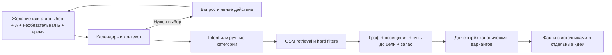

# Qadam: текущие решения и границы

## Продуктовый выбор

«До встречи есть время на маленькое открытие». Qadam связывает желание, точку А, необязательную Б и окно времени с реальными местами. По умолчанию маршрут круговой; при выбранной Б все остановки должны поместиться по пути А → места → Б. Пользователь выбирает подходящий вариант и видит, на чём он основан. Это гипотеза ценности; превосходство над картами, спрос и retention пока не доказаны.

Вместо скрытого угадывания — понятный вопрос с 2–4 действиями и своим ответом. Варианты `manual-category`, `set-origin`, `external-search`, `retry`, `edit-query` закрыты типами. Свободный ответ остаётся текстом для интерпретатора, а не доверенным intent. Предыдущие ограничения сохраняются, пока пользователь явно их не меняет; неоднозначность требует уточнения.

## Поток решения

Известный конфликт текста со стартом, например Mega против Байтерека, обрабатывается до AI. Подтверждение не геокодирует произвольный адрес и не доказывает вход. Выбор А включает пресеты, локальный поиск названных POI, полноэкранный picker со свободным pin и GPS по нажатию. Точка Б необязательна и выбирается тем же способом; повторное нажатие по карте меняет выбранный pin, подтверждение применяет его. Карта результата имеет отдельный полноэкранный режим. Мобильный viewport проверен браузером; физический iPhone и настоящий multi-touch остаются отдельной проверкой. За границей корпуса предлагаются изученные районы. Прямоугольник POI и доступность графа — разные проверки.

Категория `food` добавлена вместе с 314 source-bound OSM-заведениями, а не одним словом в enum. Ясное «покушать» распознаётся как еда; ресторан/fast_food/food_court отделены от кофе. Минимум визита 20, предпочтительно 35 минут, включая время на заказ. Меню, цены, очередь и диетические свойства не подтверждены. Для футбола/матчей/shopping нет data path; новые категории не добавляются формально ради демо. Предлагается явный внешний поиск с раскрытой границей. Уличное искусство не выдаётся за подтверждённую галерею. При поддержанной категории и неизвестной тишине/цене/Wi-Fi допустим `partial`; подтверждать неизвестный факт бессмысленно.

## Граница AI

Семантический запрос проходит строгий `IntentContract`: девять категорий, desired/excluded, all/any, цитаты с причинами и флаг уточнения. Неизвестные поля, пересечения, повторы и чужие цитаты отклоняются. Default chips не добавляют кофе к текстовому музею. При явной смене цели прежнее занятие не переносится в unsupported; неотозванные hard exclusions сохраняются. Это правило интерпретации, не гарантия отсутствия ошибок модели. Форма не доказывает понимание языка: ошибки интерпретации измеряются отдельно.

Пустой текст использует выбранные категории; при пустом выборе разрешён автоматический поиск по точкам, времени и фильтрам. При недоступном первом этапе текст не превращается в guessed route. Кнопка ручного восстановления очищает query и включает `localOnly`: обе AI-стадии пропускаются, старт/время/переключатели остаются. Это осознанный новый выбор пользователя.

Retrieval — категории, география и словарные признаки; embeddings и векторной БД нет. Код применяет hard exclusions, indoor, wheelchair и весь визит по расписанию до показа плана. `all` повышает покрытие разных категорий, но не ослабляет фильтры и бюджет: partial/empty остаются допустимыми.

Необязательная генерация для **основного** плана возвращает закрытые `summaryKey/reasonKeys/activityKey`, точные ID в исходном порядке и только разрешённые per-stop коды. Свободной venue-прозы нет. Ответ проходит shape и semantic guard; renderer не может менять маршрутные факты. Все альтернативные планы объясняются локально, без дополнительных вызовов. `generationMode` относится к основному объяснению, локальная альтернатива отмечена в diagnostics/trace. Сбой второго этапа сохраняет проверенный план.

Общий срок ожидания модельных стадий — до 14,5 секунды. Parent AbortSignal передаётся обеим стадиям, охватывает fetch/body и останавливает переход к следующей; ограниченный Promise.race защищает от транспорта, игнорирующего сигнал. API возвращает отмену отдельно от ошибки планирования. Это предел ожидания, не обещание latency.

## Время и варианты

`now`/`returnBy` требуют настоящего календарного ISO с Z или явным смещением. Проверяются длина месяца, leap year, время и UTC+5. Пользовательские wall-clock значения всегда относятся к Алматы, а не timezone устройства. Явное прошлое custom-время отклоняется; исторические offline fixtures без custom mode сохраняются для воспроизводимости.

При «Сейчас» и `returnBy` сервер заново считает остаток после интерпретации и округляет вниз до минут. Если окно или выбранное custom-отправление устарели, возвращается typed clarification. Ответ фиксирует departureAt, planComputedAt, returnBy, effectiveMinutes. Полный конечный участок до Б (или возврат в А) и buffer всегда входят в лимит. После пояснения AI время и все варианты проверяются ещё раз; истёкший custom-план снимается и в UI. Реальное прибытие не гарантируется.

До трёх остановок, обычно разных категорий; shortlist до 18. Production ranking предпочитает source richness: reviewed facts=2, исходное имя OSM=1, generated label=0, с bounded score bonus до 4. Покрытие all сравнивается раньше содержательности; все hard filters и время остаются обязательными. Альтернатива также сначала ищет другой допустимый named/curated POI. Это содержательность карточки, не отзывы, безопасность или доказанное качество места. Без callback legacy direct planner сохраняет прежнее ранжирование. CSR, binary heap и Dijkstra учитывают сеть **до** выбора. Не более пяти поисковых деревьев суммарно для всех вариантов: А, Б и не более трёх источников выбранных остановок. До трёх альтернатив заменяют последнюю остановку при сохранении допустимого префикса, используют кэш и обратное дерево конечной точки, без новых поисков; это bounded heuristic, не глобальный all-pairs optimum. Показывается до четырёх разных канонических наборов; если других выполнимых наборов с измеримой разницей затрат нет, остаётся один. Безымянные generated labels не добавляются для количества к именованной основной карточке. Перестановка тех же мест не считается разнообразием.

Для заданной Б отдельно рассчитывается прямой маршрут А→Б: минуты ходьбы, расстояние, minimumMinutes с запасом и feasible. Он не считается найденной остановкой. Известный разрыв сети между безопасно привязанными А/Б блокирует геометрическую подмену; известный длинный путь также не сокращается estimate. Отсутствие покрытия и доказанная невыполнимость — разные состояния. `RoutePlan.returnMinutes` сохраняет совместимость имени поля, но при Б означает последний участок до Б; `routeMode` и `destination` фиксируют семантику.

## Данные и содержательные объяснения

OSM snapshot: 1204 записи (890 исходных без изменений + 314 food), 81 383 узла/97 427 рёбер. Provenance сохраняет источники, дату и hash. Редакционный слой отдельно содержит 10 канонических мест, 11 явных OSM-ID, 18 атомарных фактов и 4 идеи наблюдения. У факта есть localized text, sourceUrl, checkedAt, rights. Источник проверен онлайн; полевая актуальность этим не подтверждается.

Канонические алиасы только явные. У Национального музея проверены named node внутри building polygon и совпадение адреса/официального сайта. Радиус близости сам по себе не объединяет POI. Overlay меняет отображаемое имя/описание, сохраняя исходные координаты, теги, расписание и filter/routing-поля. Исторический факт не означает, что дверь сейчас открыта; наблюдение подписывается как идея.

954 записи без raw hours, сложные часы остаются unknown; 8 indoor и 31 wheelchair=yes/designated дают мало строгих вариантов. Привязки ≤200 м — прямая, препятствия/входы не проверены. Estimate = прямая ×1,35 только при отсутствии покрытия, не для сокращения известного длинного пути. Wheelchair и запрет лестниц не сертифицируют весь путь. Матчи, ассортимент, цены, тишина и crowding не подтверждены.

Фото — отдельный overlay `data/place-photos.json`, а не источник routing/filter-полей. Две явно сопоставленные фотографии Ботанического сада/Жетысу имеют author/source/capture date/CC BY-SA 4.0. Они не показывают live-состояние или вход. Для ресторанов проверенных фото нет; Google Places/2ГИС photo API не подключены и произвольные AI-изображения вместо конкретного места не используются.

## Приватность и проверка

Приложение не пишет query/координатную историю в БД или browser storage. По действию сохраняются только ID публичных любимых мест на устройстве с очисткой. А и выбранная Б нужны серверу для расчёта; структурированные координаты и время не входят в intent payload. Query может содержать личные сведения и передаётся провайдеру. Тайлы OSM и технические журналы внешней инфраструктуры — отдельный слой.

Текущий завершённый набор: 309/309 теста и TypeScript PASS. В него входят 23 новые регрессии А→Б/food/четырёх вариантов/графовых границ; отдельно проверяется неизменность всех 890 исходных записей hash-инвариантом. Фактический UI smoke с Gemini дал четыре food-варианта в круге 45 минут и в Байтерек → Национальный музей 90 минут. Это не общий NLP benchmark и не независимый пользовательский пилот.

Исторические 167/259/278 тестов, чистая установка и intent benchmark относятся к прежнему выпуску. Замороженные 26/30 против 7/30 legacy, 27 API+3 manual и две 429 не пересчитываются новыми пробами. Новые автоматические regressions покрывают контекст, время, восстановление, abort, guards, альтернативы и источники. Итог текущего набора — в финальном gate-логе; browser QA и API smoke учитываются отдельно. Матрица 34 сценариев аудита не является 34 успешными проверками. [Метод старого прогона](EVALUATION.md) · [Новый release gate](VNEXT_RELEASE.md).

Следующие шаги после релиза: новые независимые запросы, наблюдение за добровольными пользователями, полевая проверка входов/часов и доступности, обновление корпуса и работа с квотами. Пилот, партнёрства, продажи и экономика пока гипотезы.

## Границы после финального аудита

Диалог имеет общий UI/server лимит 4000 символов и 500 на уточнение, без silent truncation. После optional enrichment время и все варианты проходят повторный guard; custom-план в UI становится неактуальным после выбранного выхода. Unknown start требует явного выбора точки вместо неявного geocoding. Переход 2ГИС использует координаты публичной точки (lon,lat), без origin/диалога и без обещания identity/входа. Данные 2ГИС не импортируются. [Проверяемый аргумент](JURY_EVIDENCE.md).

## Материалы и отправка

90-секундный ролик и 10 слайдов пока относятся к baseline v9, не к мобильному А→Б/food. [YouTube](https://youtu.be/YsN--AADsZ0) и [MP4 в GitHub](https://github.com/gojosatorukz/qadam-astana/blob/main/qadam-demo.mp4) доступны для просмотра с явной пометкой. Текущий source может быть упакован вместе с базовыми media, но комплект **NOT FINAL**. После стабилизации сайта нужны новая запись, актуальные слайды/речь и замена устаревших v9-вложений формы. В этом обновлении сохранённый draft не меняется. Отправка остаётся **HOLD**.
